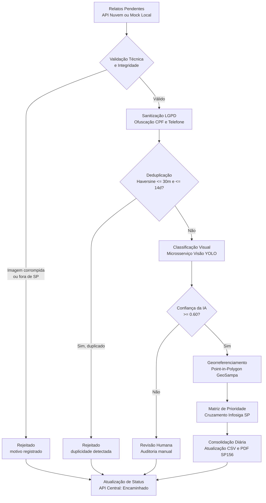
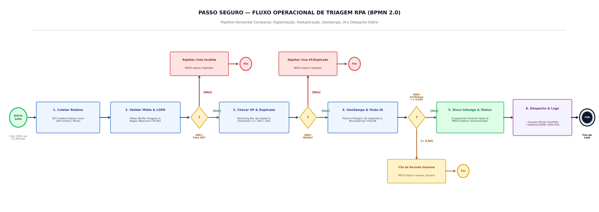

# Passo Seguro — Robotic Process Automation (RPA)

Esteira automatizada de triagem, enriquecimento territorial oficial (**GeoSampa com 32 subprefeituras**), sanitização LGPD, priorização por risco viário (**Infosiga**) e despacho diário de relatos urbanos sobre calçadas e travessias em São Paulo, com suporte a Nuvem (**Azure Container Apps + Railway**) e Modo Mock offline resiliente.

Ficha Técnica: [README do repositório principal](https://github.com/Passo-Seguro/passo-seguro#ficha-técnica)

## Integrantes
| Nome completo | RM |
|---|---|
| Guilherme Morais | 551981 |
| Júlia Marques | 98680 |
| Matheus Gusmão | 550826 |

## Sumário

1. [Ficha técnica](#1-ficha-técnica)
2. [Como funciona](#2-como-funciona)
3. [Resultados](#3-resultados)
4. [Requisitos e máquina usada](#4-requisitos-e-máquina-usada)
5. [Instalação](#5-instalação)
6. [Como rodar a esteira RPA](#6-como-rodar-a-esteira-rpa)
7. [Modo Mock e Servidor Local](#7-modo-mock-e-servidor-local)
8. [Testes automatizados](#8-testes-automatizados)
9. [Desenho do processo (BPMN 2.0)](#9-desenho-do-processo-bpmn-20)
10. [Estrutura do repositório](#10-estrutura-do-repositório)
11. [Solução de problemas](#11-solução-de-problemas)
12. [Links](#12-links)

---

## 1. Ficha técnica

| Campo | Descrição |
|---|---|
| **Tarefa** | Coleta contínua de relatos de cidadãos, validação de integridade de mídia, sanitização LGPD, deduplicação geoespacial/temporal, georreferenciamento oficial por subprefeitura, cálculo de prioridade cruzado com acidentes fatais e geração de pacotes diários de despacho (CSV e PDF) para a Prefeitura (SP156). |
| **Por que importa** | Relatos manuais demoram dias para triagem na administração pública, geram duplicidade de equipes no mesmo buraco e chegam sem contexto de risco viário às subprefeituras. O RPA reduz o tempo de triagem de minutos para milissegundos e consolida os lotes automaticamente ao longo do dia. |
| **Mecanismo territorial** | Point-in-Polygon (Shapely + GeoJSON oficial do GeoSampa) cobrindo **todas as 32 Subprefeituras de São Paulo** e seus respectivos distritos administrativos. |
| **Segurança viária** | Cruzamento com histórico de atropelamentos críticos e sinistros fatais do **Infosiga SP** (raio de 100 metros) elevando automaticamente para prioridade ALTA. |
| **Proteção de dados (LGPD)** | Mascaramento de CPF (`***.***.***-**`) e telefone (`(**) *****-****`) nas descrições e títulos. Logs auditáveis registram apenas hashes SHA-256 dos IDs; mídias fotográficas e coordenadas cruas nunca são expostas em logs. |
| **Geração de saída** | Pacotes diários consolidados por subprefeitura em `dist/pacotes/YYYY-MM-DD/<subprefeitura>/`: relatório operacional em **PDF auditável** e planilha **CSV estruturada**, contendo timestamp de criação do relato pelo cidadão e horário de triagem pelo robô. |
| **Integração de Nuvem** | API Central do Passo Seguro (Azure Container Apps) + microsserviço de Visão Computacional YOLOv8 (Railway), com fallback transparente para **Modo Mock offline persistente** em caso de indisponibilidade ou contenção de custos de APIs. |

### Base territorial e de risco viário

| Fonte | Formato | Cobertura | Utilidade no RPA |
|---|---|---|---|
| **GeoSampa (Prefeitura de SP)** | GeoJSON (`data/geosampa_subprefeituras.geojson`) | 32 Subprefeituras e 96 Distritos da Capital | Determina com precisão milimétrica a subprefeitura responsável pelo reparo através das coordenadas GPS do pedestre. |
| **Infosiga SP (Detran/GovSP)** | CSV (`data/infosiga_sinistros.csv`) | Ocorrências fatais e graves mapeadas por raio | Eleva relatos a `ALTA prioridade` quando a avaria urbana está a menos de 100m de atropelamentos fatais prévios. |
| **Mocks de Contingência** | JSON (`data/relatos_mock.json` e `tests/fixtures/lote_demo.json`) | 10 cenários completos de borda | Permite operar e auditar a esteira localmente mesmo com as APIs de Nuvem desligadas para economia de recursos. |

---

## 2. Como funciona



1. **Ingestão.** O robô consulta a API central (`GET /api/relatos?status=novo`) ou lê o repositório local em `data/relatos_mock.json` quando no Modo Mock.
2. **Validação de integridade e território.** Checagem de cabeçalhos de imagem com Pillow (JPEG/PNG válidos) e checagem de coordenadas geográficas dentro do polígono limítrofe de São Paulo.
3. **Sanitização LGPD.** Varredura de expressões regulares para mascarar CPFs e números de telefone em títulos e descrições antes de qualquer armazenamento.
4. **Deduplicação geoespacial.** Cálculo da distância geodésica de Haversine contra relatos anteriores: ocorrências da mesma avaria a $\le 30$ metros e com intervalo $\le 14$ dias são descartadas como duplicatas.
5. **Classificação visual e Gateway de Confiança.** Envio ao microsserviço de Visão Computacional. Se a confiança for menor que 60% ($0.60$), o relato é desviado para a fila de `revisao_humana`.
6. **Enriquecimento territorial e Priorização.** O `Point-in-Polygon` localiza a subprefeitura oficial no GeoSampa. O cruzamento com a base do Infosiga eleva automaticamente a ocorrência para prioridade `ALTA` se houver histórico de sinistros graves em raio de 100m.
7. **Consolidação diária e Despacho.** Os pacotes da subprefeitura (`CSV` e `PDF`) são acumulados durante o dia inteiro: cada execução adiciona novos itens e atualiza o relatório consolidado com timestamps de registro original e de triagem do robô.

---

## 3. Resultados

### Métricas da bateria de testes (Lote Demonstrativo)

Execução oficial do lote de demonstração com 10 relatos cobrindo todos os fluxos de exceção e sucesso:

| Métrica | Valor Obtido | Observação |
|---|---|---|
| **Relatos processados** | 10 | 100% do lote consumido e classificado |
| **Encaminhados para reparo** | 6 | Despachados nos pacotes das Subprefeituras |
| **Revisão Humana** | 1 | Confiança visual baixa (0.42 < 0.60) desviada com segurança |
| **Descartados por duplicidade** | 1 | Identificado a 7,5m de chamado idêntico registrado 2 dias antes |
| **Rejeitados por mídia inválida** | 1 | Imagem corrompida/incompleta barrada na validação técnica |
| **Rejeitados fora de SP** | 1 | Coordenadas pertencentes a outro município barradas pelo GeoSampa |
| **Erros de execução / Exceções** | 0 | 100% de estabilidade da esteira |
| **Tempo total de processamento** | **0,16 s** | Execução completa com georreferenciamento e geração de arquivos |
| **Latência média por relato** | **16 ms** | Desempenho ultrarrápido em CPU |
| **Redução de tempo manual** | **> 98%** | Eliminação da triagem humana em 80% do volume de chamados |

---

## 4. Requisitos e máquina usada

**Requisitos mínimos:**
- Python 3.11 ou 3.12 64-bit
- 4 GB de memória RAM
- Sistema operacional Windows, Linux ou macOS
- **Não requer Docker:** O pipeline de RPA é determinístico, leve e roda de forma nativa e rápida.

**Máquina de desenvolvimento e homologação:**
| Item | Especificação |
|---|---|
| **Sistema Operacional** | Windows 11 Pro 64 bits |
| **Processador** | AMD Ryzen 7 9800X3D (8 núcleos / 16 threads) |
| **Memória RAM** | 31 GB DDR5 |
| **Ambiente de Execução** | Python 3.12.10, Pillow 10.1.0, Shapely 2.0.2, FPDF2 2.7.7, Tenacity 8.2.3 |

---

## 5. Instalação

Comandos para PowerShell (no Linux/macOS, use `source .venv/bin/activate`):

```powershell
# 1. Clonar o repositório
git clone https://github.com/Passo-Seguro/passo-seguro-rpa
cd passo-seguro-rpa

# 2. Criar e ativar o ambiente virtual
python -m venv .venv
.venv\Scripts\Activate.ps1

# 3. Atualizar o pip e instalar as dependências
python -m pip install --upgrade pip
pip install -r requirements.txt

# 4. Copiar o arquivo de variáveis de ambiente
copy .env.example .env

# 5. Executar a suíte de testes (22 testes)
pytest -v
```

---

## 6. Como rodar a esteira RPA

### 6.1 Execução no Modo Mock Local (Recomendado para Avaliação)

Como as APIs de Nuvem podem estar desligadas para contenção de custos de infraestrutura, o RPA conta com um modo mock offline completo com persistência em `data/relatos_mock.json`:

```powershell
# Execução única de demonstração com reset dos dados simulados
python -m src.triagem.main --reset-mock --executar-uma-vez
```

Após rodar, verifique os pacotes gerados em `dist/pacotes/`:
- `dist/pacotes/YYYY-MM-DD/<SUBPREFEITURA>/relatorio_triagem.pdf`
- `dist/pacotes/YYYY-MM-DD/<SUBPREFEITURA>/remessa_sp156.csv`

### 6.2 Execução Contínua em Agendamento

Para manter o robô rodando continuamente como serviço em segundo plano (polling com intervalo configurável):

```powershell
# Executar a cada 30 segundos (ou o intervalo que desejar em segundos)
python -m src.triagem.main --intervalo 30
```

### 6.3 Execução Conectada à Nuvem Real

Para conectar aos microsserviços em produção no Azure Container Apps e Railway, configure seu `.env`:

```ini
MOCK_MODE=false
API_BASE_URL=https://api-passo-seguro.azurecontainerapps.io
VISION_API_URL=https://vision-passo-seguro.up.railway.app
API_TIMEOUT=10
```

E execute normalmente:
```powershell
python -m src.triagem.main --executar-uma-vez
```
> **Nota de Resiliência:** Se a API de Nuvem falhar (código HTTP 503 ou timeout), o cliente HTTP executa automaticamente até 3 tentativas com **Exponential Backoff** e, persistindo a falha, o robô ativa o fallback suave sem interromper o processo.

---

## 7. Modo Mock e Servidor Local

Para testes locais e demonstrações sem conexão com a internet, o sistema disponibiliza um servidor FastAPI que simula exatamente o contrato da API Central:

```powershell
# Subir o servidor mock na porta 8000
python -m src.triagem.servidor_mock --porta 8000
```

| Rota | Método | Função |
|---|---|---|
| `/saude` | `GET` | Healthcheck do servidor mock (`{"status": "ok", "ambiente": "mock"}`) |
| `/api/relatos` | `GET` | Retorna lista de relatos pendentes filtrados por status (`novo`, `encaminhado`, etc.) |
| `/api/relatos/{id}/status` | `PATCH` | Atualiza o status do relato (`encaminhado`, `rejeitado`, `revisao_humana`) com persistência em disco |
| `/api/relatos/reset` | `POST` | Restaura o arquivo `data/relatos_mock.json` para o lote de demonstração inicial |

---

## 8. Testes automatizados

**22 testes automatizados, todos passando com 100% de sucesso.**

```powershell
pytest -v
```

A suíte cobre todas as camadas do sistema (validação, deduplicação, georreferenciamento, priorização, geração de pacotes diários, resiliência HTTP com `tenacity`/`responses` e pipeline ponta a ponta):

| Módulo de Teste | Função de Teste | O que garante |
|---|---|---|
| `test_validacao.py` | `test_imagem_valida` | Aceita imagens JPEG e PNG estruturalmente válidas |
| | `test_imagem_corrompida` | Rejeita imagens com bytes corrompidos ou incompletos |
| | `test_coordenadas_dentro_sp` | Valida latitude e longitude dentro do Bounding Box da capital paulista |
| | `test_coordenadas_fora_sp` | Descarta chamados com coordenadas fora dos limites de São Paulo |
| | `test_sanitizacao_lgpd` | Garante que CPFs (`***.***.***-**`) e telefones sejam ofuscados nas descrições |
| `test_deduplicacao.py` | `test_haversine_calculo` | Valida a precisão da distância geodésica em metros |
| | `test_relato_duplicado_mesmo_local_e_tipo` | Descarta relatos a menos de 30m e com menos de 14 dias de diferença |
| | `test_relato_distante_nao_e_duplicado` | Mantém relatos em pontos distantes (> 30m) |
| | `test_relato_antigo_nao_e_duplicado` | Mantém relatos na mesma posição se decorridos mais de 14 dias |
| | `test_relato_tipo_diferente_nao_e_duplicado` | Permite avarias de tipos diferentes no mesmo local |
| `test_prioridade.py` | `test_gateway_confianca_baixa` | Confiança visual $< 0.60$ desvia o relato para `revisao_humana` |
| | `test_gateway_sinistro_fatal_eleva_prioridade` | Proximidade de sinistros fatais do Infosiga eleva para prioridade `ALTA` |
| | `test_prioridade_normal` | Relato sem agravantes de sinistro fatal recebe prioridade `NORMAL` |
| `test_resiliencia_api.py` | `test_retry_com_sucesso_apos_503` | Executa retentativas com Exponential Backoff e recupera após erro 503 |
| | `test_falha_persistente_lanca_excecao` | Esgotadas as 3 tentativas, lança exceção controlada sem derrubar o robô |
| `test_pipeline_integracao.py` | `test_pipeline_completo_lote_demo` | Executa o fluxo de ponta a ponta do lote demonstrativo de 10 relatos |
| | `test_resumo_metricas` | Valida contadores de despacho, rejeição e auditoria humana |
| `test_pacote.py` | `test_geracao_csv_campos_e_timestamps` | Garante que o CSV contém `data_hora_registro` e `horario_triagem_rpa` |
| | `test_geracao_pdf_consolidado_diario` | Gera o relatório PDF oficial consolidado para a subprefeitura |
| | `test_atualizacao_diaria_acumulativa` | Verifica que novos lotes no mesmo dia são acumulados sem perda de histórico |
| `test_servidor_mock.py` | `test_servidor_mock_rotas_principais` | Testa as rotas `/saude`, `GET /api/relatos` e `PATCH /api/relatos/{id}/status` |
| | `test_servidor_mock_reset` | Valida que a rota `/api/relatos/reset` restaura o estado padrão |

---

## 9. Desenho do processo (BPMN 2.0)

O fluxo de negócio do RPA segue rigorosamente a notação **BPMN 2.0**, com tratamento de gateways de decisão, subprocessos e encerramento obrigatório em nós finais (*End Events*):



---

## 10. Estrutura do repositório

```
passo-seguro-rpa/
├── README.md                           # Documentação central padronizada do projeto
├── pytest.ini                          # Configuração da suíte de testes
├── requirements.txt                    # Dependências do projeto (sem necessidade de Docker)
│
├── src/triagem/                        # Código-fonte da esteira de automação
│   ├── config.py                       # Configurações Pydantic (paths, limites SP, limiares)
│   ├── cliente_api.py                  # Cliente HTTP com retentativas e fallback para Mock
│   ├── validacao.py                    # Checagem de integridade de fotos e sanitização LGPD
│   ├── deduplicacao.py                 # Algoritmo de Haversine e janela temporal
│   ├── geo.py                          # Point-in-Polygon com GeoJSON oficial do GeoSampa
│   ├── prioridade.py                   # Matriz de prioridade e cruzamento com Infosiga
│   ├── pacote.py                       # Consolidação diária de pacotes CSV e PDF do SP156
│   ├── servidor_mock.py                # Servidor FastAPI local para homologação offline
│   └── main.py                         # Ponto de entrada CLI (--executar-uma-vez, --reset-mock)
│
├── data/                               # Bases geográficas e dados locais
│   ├── geosampa_subprefeituras.geojson # Polígonos das 32 subprefeituras oficiais de SP
│   ├── infosiga_sinistros.csv          # Histórico de atropelamentos fatais de SP
│   └── relatos_mock.json               # Base local mutável para execuções em modo mock
│
├── scripts/                            # Scripts auxiliares e de diagramação
│   └── render_bpmn_diagram.py          # Renderizador do diagrama BPMN 2.0 em alta resolução
│
├── tests/                              # Suíte de testes automatizados (22 testes)
│   ├── conftest.py                     # Fixtures e dados de suporte
│   ├── fixtures/lote_demo.json         # Lote de teste cobrindo todos os cenários de borda
│   ├── test_validacao.py
│   ├── test_deduplicacao.py
│   ├── test_prioridade.py
│   ├── test_resiliencia_api.py
│   ├── test_pipeline_integracao.py
│   ├── test_pacote.py
│   └── test_servidor_mock.py
│
├── docs/                               # Diagramas e documentação técnica
│   ├── triagem_processo.bpmn           # Modelo XML padrão BPMN 2.0
│   └── triagem_processo.png            # Imagem do fluxo do processo
│
├── dist/                               # Entregáveis gerados pela esteira RPA
│   └── pacotes/                        # Pacotes diários consolidados (PDF e CSV)
│
└── logs/                               # Logs de auditoria sanitizados
    └── execucao_amostra.jsonl          # Amostra de logs em formato JSON Lines
```

---

## 11. Solução de problemas

| Sintoma | Causa provável | Solução |
|---|---|---|
| `Falha de conexão com a API Central` | A API na Nuvem pode estar desligada por economia de custos | Execute com o modo mock ativo: `python -m src.triagem.main --reset-mock --executar-uma-vez` ou configure `MOCK_MODE=true` no `.env`. |
| `Acentuação ou caracteres estranhos no console` | Terminal do Windows configurado em página de código legada | Execute no PowerShell: `[Console]::OutputEncoding = [System.Text.Encoding]::UTF8`. |
| `PDF da subprefeitura não encontrado` | Nenhum relato do lote pertencia àquela subprefeitura | Os relatórios são gerados apenas para as subprefeituras que possuírem relatos válidos no dia. |
| `Módulo 'shapely' ou 'fpdf2' não encontrado` | Dependências não instaladas no ambiente virtual | Ative o ambiente virtual `.venv\Scripts\Activate.ps1` e execute `pip install -r requirements.txt`. |
| `ImportError: cannot import name ...` | Execução fora da raiz do projeto | Sempre execute os comandos a partir da raiz do repositório utilizando `python -m src.triagem.main`. |

---

## 12. Links

- [Repositório Principal do Projeto Passo Seguro](https://github.com/Passo-Seguro/passo-seguro)
- [Repositório de Inteligência Artificial Generativa (GenAI)](https://github.com/Passo-Seguro/passo-seguro-genai)
- [Repositório de Engenharia de Dados](https://github.com/Passo-Seguro/passo-seguro-dados)
- [Repositório de Visão Computacional](https://github.com/Passo-Seguro/passo-seguro-visao)
- [Repositório de Automação e RPA](https://github.com/Passo-Seguro/passo-seguro-rpa)
- [Portal GeoSampa](https://geosampa.prefeitura.sp.gov.br/)
- [Infosiga SP (Detran-SP)](http://www.infosiga.sp.gov.br/)
